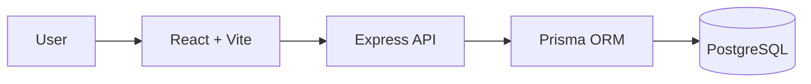

<!-- LinkShort README -->

<div align="center">

# LinkShort

### Shorten links. Keep them organized. Understand every click.

A bilingual, locally hosted URL shortener with user authentication, private link management, and click analytics.

[](https://nodejs.org/)
[](https://react.dev/)
[](https://www.typescriptlang.org/)
[](https://www.postgresql.org/)
[](https://www.prisma.io/)

[Features](#-features) · [Tech Stack](#-technology-stack) · [Getting Started](#-getting-started) · [Project Structure](#-project-structure)

</div>

---

## معرفی کوتاه

**LinkShort** یک پروژه کوتاه‌کننده لینک با قابلیت ثبت‌نام و ورود کاربران، مدیریت لینک‌های اختصاصی و مشاهده آمار کلیک است. این پروژه با هدف یادگیری و نمایش عملی توسعه فول‌استک طراحی شده و در حال حاضر برای اجرا و نمایش محلی آماده شده است.

## ✨ Features

- **User authentication** — Register and sign in to a personal account.
- **Private link management** — Each user manages their own shortened links.
- **URL shortening** — Create a compact link from a longer destination URL.
- **Click tracking** — Record visits to shortened links.
- **Analytics dashboard** — Review link activity and click statistics.
- **Bilingual interface** — Persian and English interface support.
- **Local development environment** — PostgreSQL runs through Docker Compose.

## 🧰 Technology Stack

| Area | Technologies |
| --- | --- |
| Frontend | React 19, TypeScript, Vite |
| UI and routing | React Router, Lucide React |
| Localization and charts | i18next, Recharts |
| Backend | Node.js, Express 5, TypeScript |
| Database and ORM | PostgreSQL 17, Prisma 6 |
| Authentication | JSON Web Tokens, bcryptjs, cookie-parser |
| Development environment | Docker Compose, npm workspaces |

## 🏗️ Architecture

The application is organized as a frontend, an Express API, and a PostgreSQL database.



## 🚀 Getting Started

LinkShort is currently intended for **local development and educational demonstration** on Windows. It is not configured as a public production service.

### Prerequisites

Install the following:

- [Node.js LTS](https://nodejs.org/)
- [Docker Desktop](https://www.docker.com/products/docker-desktop/)
- Git (to clone the repository)

Start Docker Desktop and wait until its engine is ready before continuing.

### 1. Clone the repository

Open Command Prompt or PowerShell:

```bash
git clone https://github.com/Servin1414/LinkShort.git
cd LinkShort
```

### 2. Run the setup script

Double-click `SETUP.bat`, or run it from the project directory:

```cmd
SETUP.bat
```

The setup script:

1. Checks that Node.js, npm, and Docker are available.
2. Installs the project dependencies.
3. Creates the local backend environment file if it does not exist.
4. Starts the PostgreSQL container.
5. Generates the Prisma Client and prepares the database schema.

### 3. Start the application

After setup completes, run:

```cmd
START.bat
```

Keep the terminal window open while using the application.

### 4. Open LinkShort

| Service | Local address |
| --- | --- |
| Frontend | http://127.0.0.1:5173 |
| Backend health check | http://127.0.0.1:3000/api/health |

Register an account before creating and managing shortened links.

## 📁 Project Structure

```text
LinkShort/
├── backend/
│   ├── prisma/
│   │   └── schema.prisma
│   └── src/
│       ├── config/
│       ├── controllers/
│       ├── middleware/
│       ├── routes/
│       ├── utils/
│       └── server.ts
├── frontend/
│   └── src/
│       ├── pages/
│       ├── services/
│       ├── App.tsx
│       └── main.tsx
├── .env.example
├── docker-compose.yml
├── SETUP.bat
├── START.bat
└── package.json
```

## 🛠️ Useful Commands

Run these commands from the project root:

| Command | Description |
| --- | --- |
| `npm run dev` | Start the frontend and backend development servers |
| `npm run build` | Build the frontend and backend |
| `npm run db:generate` | Generate the Prisma Client |
| `npm run db:push` | Synchronize the database schema |
| `npm run db:studio` | Open Prisma Studio |

The scripts above require the dependencies to be installed and a valid local environment configuration.

## 🗄️ Database

LinkShort uses PostgreSQL with Prisma. Docker Compose manages the local database container, while a named Docker volume persists database data between restarts.

To view database logs:

```cmd
docker compose --env-file backend/.env logs postgres
```

**Important:** Do not remove the `linkshort_pgdata` Docker volume if you need to keep your local users and links.

## 🔐 Environment and Security

- The local environment file is `backend/.env` and must remain private.
- `backend/.env` is excluded from Git; `.env.example` is provided as a configuration template.
- The setup script generates a random JWT secret when it creates the environment file.
- The default configuration binds PostgreSQL to `127.0.0.1`; it is intended for local use.

Never commit real passwords, tokens, or private keys.

## 🧯 Troubleshooting

<details>
<summary><strong>Docker is not running</strong></summary>

Open Docker Desktop, wait until the engine is ready, and run `SETUP.bat` or `START.bat` again.

</details>

<details>
<summary><strong>The application does not start</strong></summary>

Run `SETUP.bat` first and review the error shown in the terminal. Confirm that the required ports are available.

</details>

<details>
<summary><strong>The frontend cannot connect to the backend</strong></summary>

Make sure the backend is running and that port `3000` is available. You can check the API at http://127.0.0.1:3000/api/health.

</details>

<details>
<summary><strong>PostgreSQL does not start</strong></summary>

Check the database container logs:

```cmd
docker compose --env-file backend/.env logs postgres
```

Also confirm that Docker Desktop is running and port `5432` is not already occupied.

</details>

---

<div align="center">

**LinkShort** · Built as a full-stack educational project.

[Repository](https://github.com/Servin1414/LinkShort)

</div>
