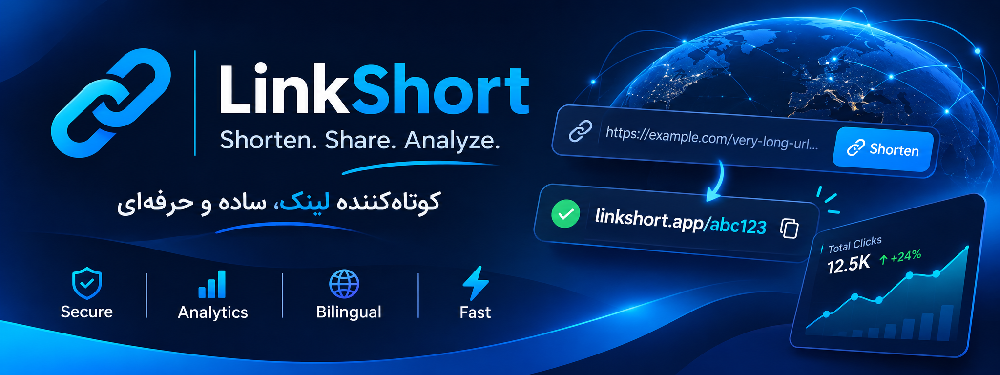
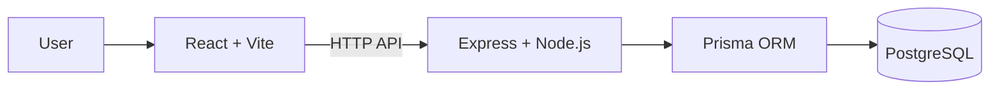

<!-- LinkShort README -->

<div align="center">



<h1>
  
  LinkShort
</h1>

### Shorten links. Organize them. Track every click.

A full-stack URL shortener with account-based link management and click analytics.

[](https://nodejs.org/)
[](https://react.dev/)
[](https://www.typescriptlang.org/)
[](https://vite.dev/)
[](https://expressjs.com/)
[](https://www.postgresql.org/)
[](https://www.prisma.io/)

[Features](#-features) · [Tech Stack](#-technology-stack) · [Setup](#-getting-started) · [Structure](#-project-structure) · [Security](#-security-notes)

</div>

---

## معرفی کوتاه

**LinkShort** یک ابزار کوتاه‌سازی لینک با امکان ساخت حساب کاربری، مدیریت لینک‌های اختصاصی و مشاهده آمار کلیک است. این پروژه با هدف یادگیری و نمایش عملی توسعه فول‌استک ساخته شده و در حال حاضر برای اجرا به‌صورت محلی طراحی شده است.

## ✨ Features

- **URL shortening** — Turn long destination URLs into short links.
- **User accounts** — Register and sign in to access a personal workspace.
- **Private link management** — Each account manages its own links.
- **Click tracking** — Record visits to shortened links.
- **Analytics dashboard** — View click totals and daily activity.
- **Bilingual interface** — Switch between Persian and English.
- **Local database environment** — Run PostgreSQL with Docker Compose.

## 🧰 Technology Stack

| Layer | Technologies |
| --- | --- |
| Frontend | React 19, TypeScript, Vite 7 |
| Routing and UI | React Router 7, Lucide React |
| Localization and charts | i18next, Recharts |
| Backend | Node.js, Express 5, TypeScript |
| Database | PostgreSQL 17, Prisma 6 |
| Authentication | JSON Web Tokens, bcryptjs, cookie-parser |
| Local development | Docker Compose, npm workspaces |

## 🏛️ Architecture

LinkShort uses a separate frontend and backend, with Prisma connecting the API to PostgreSQL.



## 🚀 Getting Started

> **Project status:** LinkShort is currently intended for local development and educational demonstration. It is not configured as a publicly hosted production service.

### Prerequisites

- [Node.js LTS](https://nodejs.org/)
- [Docker Desktop](https://www.docker.com/products/docker-desktop/)
- [Git](https://git-scm.com/)

Make sure Docker Desktop is running before starting the setup.

### 1. Clone the repository

Open Command Prompt or PowerShell:

```bash
git clone https://github.com/Servin1414/LinkShort.git
cd LinkShort
```

### 2. Install and configure

Run the setup script from the project root:

```cmd
SETUP.bat
```

The script automatically:

1. Checks Node.js, npm, and Docker.
2. Installs project dependencies.
3. Creates `backend/.env` if it does not already exist.
4. Starts the PostgreSQL container and waits for it to become healthy.
5. Generates the Prisma Client and synchronizes the database schema.

### 3. Start the application

After setup completes:

```cmd
START.bat
```

Keep the terminal window open while using LinkShort. Press `Ctrl+C` in that window to stop the development servers.

### 4. Open the application

| Service | Local URL |
| --- | --- |
| Frontend | http://127.0.0.1:5173 |
| Backend health check | http://127.0.0.1:3000/api/health |

Create an account before using the link management features.

## 📁 Project Structure

```text
LinkShort/
├── backend/
│   ├── prisma/
│   │   └── schema.prisma
│   └── src/
│       ├── config/
│       ├── controllers/
│       ├── middleware/
│       ├── routes/
│       ├── utils/
│       └── server.ts
├── frontend/
│   └── src/
│       ├── pages/
│       ├── services/
│       ├── App.tsx
│       └── main.tsx
├── .env.example
├── docker-compose.yml
├── SETUP.bat
├── START.bat
├── package.json
└── package-lock.json
```

## ⚙️ Useful Commands

Run these commands from the project root after setup:

| Command | Description |
| --- | --- |
| `npm run dev` | Start the frontend and backend development servers |
| `npm run build` | Build the frontend and backend |
| `npm run db:generate` | Generate the Prisma Client |
| `npm run db:push` | Synchronize the database schema |
| `npm run db:studio` | Open Prisma Studio |

## 🗄️ Database

PostgreSQL runs in Docker using the configuration in `docker-compose.yml`. A named Docker volume stores database data between container restarts.

To inspect PostgreSQL logs:

```cmd
docker compose --env-file backend/.env logs postgres
```

Do not delete the database volume if you want to preserve your local accounts and links.

## 🔐 Security Notes

- Keep `backend/.env` private. It contains database credentials and the JWT signing secret.
- The local environment file is excluded from Git; `.env.example` is provided as a template.
- The setup script generates a random JWT secret when it creates the environment file.
- PostgreSQL is bound to `127.0.0.1` for local development.
- Never commit real passwords, tokens, or private keys.

## 🧯 Troubleshooting

<details>
<summary><strong>Docker is not running</strong></summary>

Open Docker Desktop, wait for the engine to become ready, then run `SETUP.bat` or `START.bat` again.

</details>

<details>
<summary><strong>Setup or application startup fails</strong></summary>

Run `SETUP.bat` first and read the terminal output. Check that the required ports are available and that Docker Desktop is running.

</details>

<details>
<summary><strong>The frontend cannot connect to the backend</strong></summary>

Make sure the backend server is running and port `3000` is available. Check the API health endpoint at http://127.0.0.1:3000/api/health.

</details>

<details>
<summary><strong>PostgreSQL does not start</strong></summary>

Check the container logs:

```cmd
docker compose --env-file backend/.env logs postgres
```

Also verify that Docker Desktop is running and port `5432` is not being used by another service.

</details>

---

<div align="center">

**LinkShort** · A full-stack educational project.

[View Repository](https://github.com/Servin1414/LinkShort)

</div>
